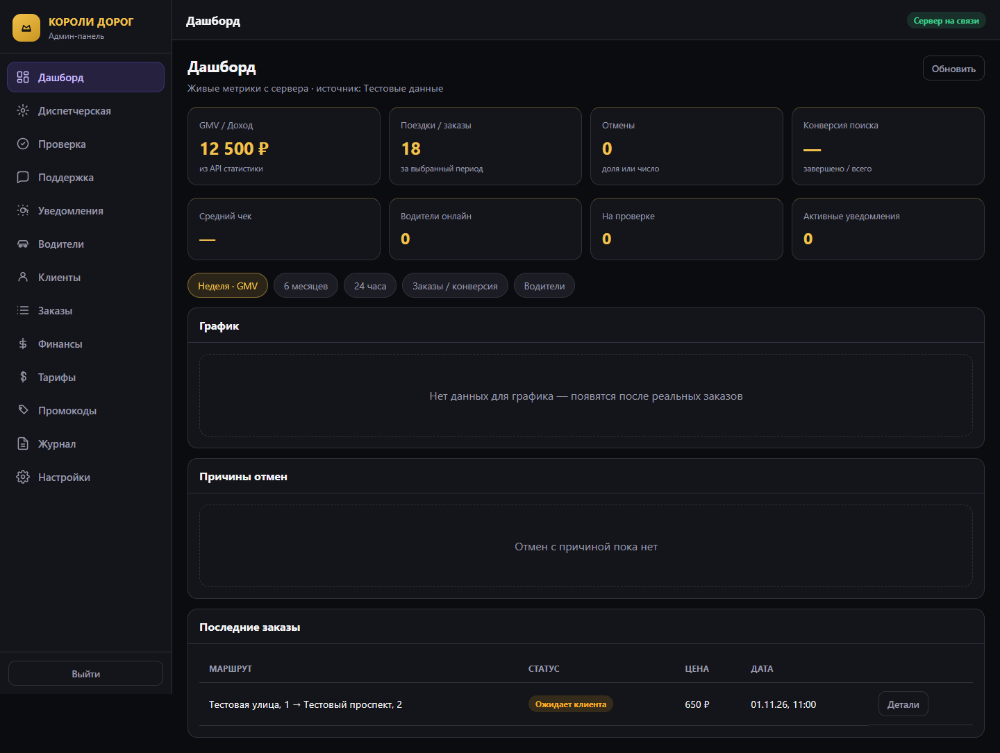
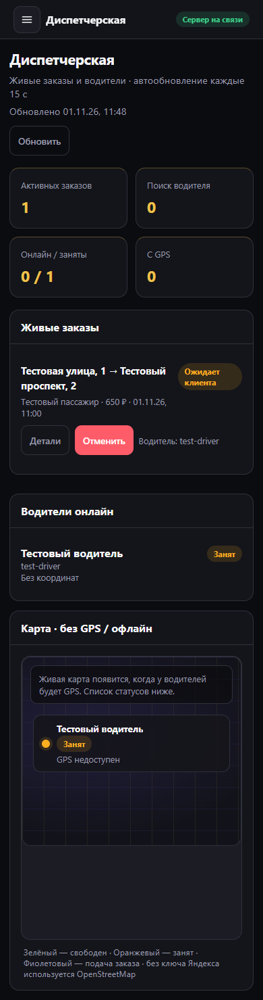

# TaxiProRun · КОРОЛИ ДОРОГ

Такси, трезвый водитель и диспетчерская: Flutter-приложения пассажира и водителя, общий NestJS API и веб-админка.

[](https://github.com/kirill2006788-cloud/TaxiProRun/actions/workflows/ci.yml)

**[Подробный аудит и список исправлений →](docs/AUDIT_2026-11-01.md)**

## Что внутри

| Каталог | Компонент |
|---|---|
| `lib/` | Пассажир: маршрут, тариф, заказ, поездка, история, профиль |
| `driver_app/` | Водитель: анкета, документы, линия, поездка |
| `backend/api/` | Заказы, цены, диспетчеризация, чат, OTP, поддержка |
| `admin/` | Водители, проверка, диспетчерская, тарифы, заказы, журнал |
| `deploy/`, `compose.yml` | Локальное окружение с общим адресом админки и API |

## Админка

Скриншоты с синтетическими данными для проверки интерфейса:





## Запуск API и админки вместе

Нужен Docker Compose. Скопируйте `deploy/.env.example` в `deploy/.env`, задайте разные случайные `JWT_SECRET` и `ADMIN_JWT_SECRET`, логин и пароль администратора длиной от 12 символов.

```sh
docker compose --env-file deploy/.env up --build -d
```

Админка: [http://localhost:8080](http://localhost:8080). Проверка API: [http://localhost:8080/api/health/ready](http://localhost:8080/api/health/ready).

Redis хранит данные в отдельном томе с AOF. В этой конфигурации API и Redis доступны только внутри Docker. Для доступа с телефона нужен отдельный сетевой адрес сервера; `localhost` на телефоне указывает на сам телефон. Для Android-эмулятора на этом компьютере обычно используется `http://10.0.2.2:8080`.

Для внешней эксплуатации нужны HTTPS, резервные копии, настройки провайдеров и контрольный сценарий из аудита. Compose-конфигурация не заменяет настройку рабочего сервера.

## Запуск приложений

Проверенная версия Flutter: **3.41.5 / Dart 3.11.3**.

```sh
flutter pub get
flutter run --dart-define=USE_MOCK_API=false --dart-define=API_BASE_URL=https://your-api.example
```

Водитель:

```sh
cd driver_app
flutter pub get
flutter run --dart-define=API_BASE_URL=https://your-api.example
```

Пассажир и водитель по умолчанию используют реальный API. Для пассажирского демо явно задайте `--dart-define=USE_MOCK_API=true`. Водительское демо включается настройками приложения. Для разработки используйте отдельное окружение, а не действующий сервер.

Ключи карт и push: `keys.local.env.example`, `docs/YANDEX_MAPS_SETUP.md`, `docs/GEO_SEARCH_SETUP.md`, `docs/PUSH_SETUP.md`. Реальные значения, Firebase-конфигурации и файлы подписи не входят в репозиторий.

## Проверки

```sh
flutter analyze --no-pub
flutter test --no-pub
cd driver_app
flutter analyze --no-pub
flutter test --no-pub
```

API (Node.js 22):

```sh
cd backend/api
npm ci
npm run typecheck
npm run build
npm run test:unit
```

Админка:

```sh
cd admin
npm ci
npm test
npx playwright install chromium
npm run test:ui
```

Браузерная проверка использует тестовые данные и сохраняет изображения в `artifacts/`. Реальный Redis-сценарий запускается отдельным заданием CI в изолированной базе 15. Подробности — в [аудите](docs/AUDIT_2026-11-01.md).

## Границы готовности

Проверки исходников и локального интерфейса не подтверждают доставку SMS, фоновые push, настоящую оплату, качество карт на устройстве и выпуск в магазины. Для них нужны действующие настройки и проверка на телефонах. Возвраты через неподключённый провайдер явно недоступны. История заказов пока хранится в Redis с ограниченным сроком жизни.

Публикация этого репозитория не обновляет существующий VPS автоматически. Старые одноразовые скрипты с реквизитами сервера и посторонние проекты исключены из Git.
