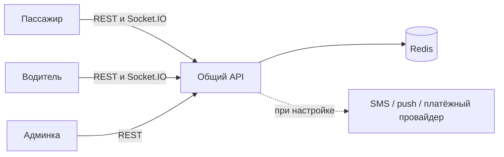

# TaxiProRun / «КОРОЛИ ДОРОГ»: аудит и доработка

Дата: **1 ноября 2026 года**. Проверены актуальные исходники пассажирского приложения, приложения водителя, NestJS API и веб-админки. Старый `PRODUCT_AUDIT.md` описывает состояние июля и не является результатом этой проверки.

## Результат

Исправлены ошибки расчёта цены, назначения водителя, авторизации админки, изоляции чата и показа персональных документов. Улучшены обработка нестабильной сети, обновление диспетчерской и мобильная компоновка панели. Добавлены проверки на регрессии и автоматическая проверка проекта в GitHub Actions.

Публикация исходников на GitHub и выпуск работающего коммерческого сервиса — разные этапы. Этот отчёт отдельно фиксирует проверенное поведение и подключения, для которых нужны реальные настройки инфраструктуры.

## 1. Структура системы

| Компонент | Каталог | Назначение |
|---|---|---|
| Пассажир | `lib/`, `test/` | Авторизация, маршрут, тариф, заказ, поездка, история, профиль |
| Водитель | `driver_app/` | Анкета и документы, линия, предложения, статусы поездки |
| Сервер | `backend/api/` | Общие заказы, тарифы, диспетчеризация, чат, OTP, поддержка |
| Администратор | `admin/` | Назначение, проверка водителей, заказы, тарифы, поддержка, журнал |
| Локальное окружение | `compose.yml`, `deploy/` | Redis, API и nginx с общим адресом для админки и API |
| Проверки | `.github/workflows/ci.yml` | Flutter, сервер, Redis-интеграция и браузер |

## 2. Исправления, влияющие на деньги и заказы

### Обычное такси больше не завершается по формуле трезвого водителя

Раньше финальный расчёт всегда переходил к поминутной формуле для трезвого водителя, включая обычное такси. Поездка с согласованной ценой 650 ₽ могла получить существенно большую итоговую сумму. Для `serviceType=taxi` финальная цена теперь сохраняет согласованную стоимость маршрута. Проверка фиксирует пример 650 ₽ и 15 минут.

### Скидка подтверждается сервером и применяется один раз

Предварительный расчёт может содержать подсказку о скидке. Создание заказа теперь сначала считает базовую стоимость без переданного клиентом процента, затем применяет скидку из серверного профиля. В заказе раздельно сохраняются исходная и согласованная суммы. Завершение поездки такси не применяет промокод повторно.

В интеграционной проверке клиент передаёт 99%, а профиль разрешает 20%: заказ должен получить только 20%, итог должен совпасть с принятой суммой.

### Повторная отправка при потере ответа

Автоматический повтор HTTP POST отключён в обоих приложениях: сервер мог уже создать заказ или отправить сообщение до потери ответа. Повторное чтение при временном сетевом сбое сохранено. Для создания заказа сервер также поддерживает `requestId`; повтор того же запроса проверяется интеграционным сценарием.

Ручное повторение после неоднозначного сбоя всё ещё требует проверки активного заказа. Полная идемпотентность всех операций и распределённые транзакции платежей остаются отдельной задачей.

### Устаревшая цена и закрытый экран

При изменении маршрута или тарифа предыдущий запрос цены сразу теряет актуальность. Старый ответ больше не возвращает цену уже очищенному маршруту. При закрытии провайдера запросы маршрута и цены инвалидируются до освобождения ресурсов.

### Назначение водителя

Админское назначение раньше удаляло `+` из номера, хотя OTP сохраняет пользователя с `+7`. Поиск мог не найти зарегистрированного водителя. Теперь поиск учитывает текущие и старые ключи, сохраняет найденный идентификатор и использует его в заказе и событиях.

## 3. Авторизация и персональные данные

| Найденная проблема | Изменение |
|---|---|
| Посторонний сокет вступал в комнату поездки до проверки участника | Вступление выполняется после успешной проверки и сохранения сообщения |
| Одно сообщение доставлялось через несколько комнат отдельно | Комнаты объединяются в одну отправку Socket.IO |
| Уведомление водителям отправлялось всем клиентам через общий broadcast | Используются только комнаты выбранной аудитории |
| Клиентские сокеты не вступали в общую комнату клиентов | Добавлена подписка на `clients` при авторизации |
| Админский токен с отдельным ключом не открывал детали заказа | Чтение заказа и чата распознаёт админский ключ с проверкой роли, issuer и audience |
| Скан паспорта/проверочное селфи могли подставляться в публичный аватар | Публичное поле использует только явно заданный аватар |
| Обновление истёкшего токена использовало декодирование | Подпись проверяется даже в разрешённом периоде после истечения |
| В разработке был встроенный номер с тестовым OTP | Тестовый вход возможен только при явной настройке переменных; в production отключён |
| CORS сокета и HTTP отличались, localhost проверялся по префиксу | Общая политика, точная проверка имени хоста, без localhost-исключений в production |
| IP клиента брался напрямую из переданного заголовка | Используется IP запроса с явно заданным списком доверенных прокси |

Полная ротация refresh-токенов, принудительный выход на всех устройствах и отдельная модель ролей сотрудников пока не реализованы. Текущий админский доступ остаётся единым административным аккаунтом.

## 4. Админка: удобство и производительность

- Общий тайм-аут запроса 15 секунд; понятные сообщения об отсутствии связи и неверном URL.
- Видимый статус соединения в верхней панели.
- Одинаковые одновременные GET-запросы объединяются.
- Смена сервера очищает прежний токен, чтобы не передавать его другому хосту.
- URL приводится к единому `/api`, исключается `/api/api`.
- HTML вместо JSON распознаётся как ошибка адреса/маршрутизации.
- 403 не вызывает ненужный выход из аккаунта; 401 завершает сессию.
- При переходе между разделами и выходе из аккаунта старые запросы отменяются.
- Диспетчерская планирует следующее обновление после завершения текущего; запросы не накладываются.
- Фоновая вкладка не выполняет обновления диспетчерской.
- При обновлении меняются заказы, список водителей и счётчики, а не только карточки заказов.
- Статус `waiting` отображается и учитывается как активный.
- На узком экране счётчики расположены в две колонки, кнопки имеют удобную высоту.
- Повышен контраст второстепенного текста; суммы используют цифры одинаковой ширины.
- Добавлены видимый фокус, Escape, удержание клавиатурного фокуса в диалоге и возврат к исходной кнопке.
- Скрытое мобильное меню исключено из клавиатурной навигации.
- Учитывается настройка уменьшенного движения.

Скриншоты в `docs/preview/` получены с синтетическими данными. Это проверка компоновки, а не подтверждение подключения к действующему серверу.

## 5. Сервер и запуск

`REDIS_URL` теперь действительно используется Redis-клиентом. Ограничено число повторов команды при недоступности Redis. HTTP-ограничитель частоты использует существующее хранилище лимитов; в обычной конфигурации это Redis, общий для процессов. Health-проверки не зависят от HTTP-лимитера.

Добавлены использование `PORT` и завершение ресурсов через shutdown hooks. Локальная конфигурация Docker Compose объединяет админку, API, Socket.IO и Redis с AOF и отдельным томом. Redis и API не публикуются наружу отдельными портами.

Возвраты через заглушку больше не помечают платёж возвращённым: до подключения реального адаптера сервер сообщает, что операция недоступна. Это предотвращает расхождение внутреннего статуса и фактического движения денег.

## 6. Проверки

| Проверка | Что подтверждает |
|---|---|
| `flutter analyze --no-pub` | Статический анализ пассажирского приложения |
| `flutter test --no-pub` | Расчёты, бронирование, статусы, ошибки сети, базовый интерфейс |
| Анализ и тесты `driver_app/` | Отдельный пакет водителя и его зависимости |
| `npm ci`, `npm run build`, `npm run test:unit` в API | Воспроизводимая установка, TypeScript и регрессии сервера |
| `node --test admin/tests/api.test.cjs` | Адрес API, отмена старых запросов, сессия, одинаковые запросы, неверный ответ |
| `npm run test:ui` в админке | Вход, dashboard, диспетчерская, ожидание клиента, диалог, разделы, 390 px, выход |
| `backend/api/tests/integration.cjs` | Реальный Redis, вход админа, цена, скидка, повтор заказа, назначение, чат, завершение, история и журнал |

Интеграционный сценарий разрешён только с `ALLOW_TEST_REDIS=1`, локальным Redis и базой `/15`. Он создаёт только синтетические данные и не должен запускаться против рабочей установки. GitHub Actions предоставляет отдельный Redis для этого задания.

Локально получены: 44 успешных теста пассажира; 2 успешных теста водителя; чистый анализ обоих пакетов; успешная TypeScript-сборка и 9 серверных проверок (включая набор проверок хранилища/статусов); 5 тестов API-клиента админки и успешный браузерный сценарий. Проверочный Android APK пассажира собран. Результаты серверной интеграции и повторные проверки видны в GitHub Actions.

Проверка существующих адресов из исходников не подтвердила readiness: запрос к адресу по IP завершился ошибкой SSL, `/api/health/ready` на домене вернул 404. Это наблюдение из текущего окружения, а не доказательство причины сбоя или состояния всех маршрутов. Проверенный новый код пока не развёрнут на этом VPS.

Android APK собирается отдельно от тестов Flutter. Подпись release, работа на физических устройствах, фоновые уведомления и iOS требуют самостоятельной проверки в соответствующей среде.

## 7. Что требуется для коммерческого запуска

| Область | Состояние / следующий шаг |
|---|---|
| Общий сервер | Настроить актуальный HTTPS-домен в обоих приложениях и админке; публикация репозитория сама по себе сервер не обновляет |
| Карта и адреса | Нужны действующие ключи MapKit, геоподсказок/геокодера и маршрутизации; серверных `/geo/suggest` в текущем модуле нет |
| OTP | Подключить SMS-провайдера и проверить доставку на реальные номера |
| Push | Подключить Firebase отдельно для клиента и водителя; проверить фон/закрытое приложение на устройствах |
| Онлайн-оплата | Нужны реальный провайдер и проверенный checkout/webhook; локальные тесты не подтверждают списание денег |
| Возврат | Адаптер возвратов отсутствует; операция явно недоступна |
| Чеки | Внутренние записи о платеже не заменяют подключение фискального провайдера |
| Хранение данных | Заказы остаются в Redis с существующим TTL; AOF не заменяет резервные копии и долговременную БД |
| Защита от гонок | Полные распределённые транзакции промокодов, бонусов и создания заказа ещё требуют отдельного проектирования |
| Release | Подключить собственные ключи подписи, проверить Android/iOS и заполнить данные магазинов |
| Секреты | Старые скрипты с реквизитами исключены из публикации; для эксплуатации перенести настройки в окружение и заменить устаревшие реквизиты |

## 8. Контрольный сценарий на двух устройствах

1. Запустить API, проверить `/api/health/ready`, открыть админку на том же окружении.
2. Пассажир и водитель проходят настоящий OTP; заявка водителя появляется в проверке.
3. Администратор проверяет документы и разрешает работу.
4. Водитель выходит на линию и передаёт актуальные координаты.
5. Пассажир выбирает адреса, тариф и наличные; цена подтверждается сервером.
6. Заказ появляется в диспетчерской; водитель принимает его или назначается администратором.
7. Статусы проходят `accepted → enroute → arrived → waiting → started → completed`.
8. Чат виден только участникам, сообщение не дублируется.
9. Итог обычного такси совпадает с согласованной ценой; скидка применяется один раз.
10. Поездка видна пассажиру, водителю и администратору; журнал отражает назначение.
11. Отдельно проверить потерю сети, переподключение, отмену и перезапуск приложения.
12. Push, реальную оплату и возврат проверять только после подключения соответствующих провайдеров.
